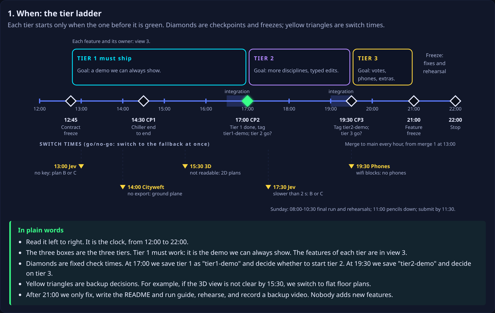

# Escape Plan

**Ask your building: can my sofa get in, can my parent's wheelchair get out?**

## The problem

Every discipline has the same hidden question: can my thing get through the building? The new
chiller in year 15. The 4 m glass panel on delivery day. The wheelchair at the terrace door.
Smoke reaching the stair before the people. A drain that must cross a beam. A load that needs a path to
the ground. Each trade checks its own path alone and late, and the clash shows up on site.

## What the demo shows

Escape Plan answers the questions people ask about a building. A home buyer asks if the sofa
gets in. A family asks if a parent's wheelchair gets out. An owner asks if the shaft can be
widened for a new chiller. Press **Show me** and the building answers each one, with the place
and the numbers. Fix one answer and every other answer is checked again: widen the shaft and
the structure answer turns to No at beam B2. It is a quick check of sizes and routes, not a
code review.

A deterministic solver decides every Yes or No and shows the numbers. Jev (TypeSafe AI)
turns typed or spoken edits into actions and gives each discipline a vote bubble. Cityweft can
put the building in its real NYC block as a backdrop.

## Quickstart

Needs Node 22.18 or later (`.nvmrc`).

```sh
git clone git@github.com:purveshluhar/escape-plan.git
cd escape-plan
npm ci
npm run dev      # http://localhost:5173
npm test         # contract, solver, data schema checks
npm run check    # typecheck + test + build: run before every merge
```

## Folder map

Roles: P1 @purveshluhar, P2 @justinjao, P3 and P4 @minsookim1014 and @jackwayfeel (together, on both roles), P5 @kalunkuo.

| Folder | Owner | What it is |
|---|---|---|
| `contract/` | P1 | Shared TypeScript types and JSON Schemas. Read first. |
| `solver/` | P1 | Deterministic pass or fail per token (Yes or No on screen). |
| `viewer/` | P2 | three.js isometric cutaway and the route of each thing. |
| `app/` | P3 | App shell: edits, answers, text box, phone controllers. |
| `server/` | P1 | Small local server: keys, Jev and plan B or C calls, votes, phone sockets (tier 2 and 3). |
| `design/` | P4 | Colours, icons, motion, sound, demo script. |
| `data/` | P5 | `building.json` and the hand-checked `expected.json`. |
| `docs/` | P1 | Plan, ADRs, agent docs. |
| `.claude/skills/` | P1 | Team skills for coding agents. |

## How we work with agents

Every person codes with an AI agent against one frozen contract. Start with
[AGENTS.md](AGENTS.md): the rules, folder ownership, commands, merge rhythm and the first prompt
for your agent. Team skills are mapped in [docs/agents/skills.md](docs/agents/skills.md).
Decisions are in [docs/adr/](docs/adr/), and terms in [GLOSSARY.md](GLOSSARY.md).

## Tiers and gates

[](docs/plan-graph.html)

The full visual plan (tier ladder; how the parts connect; who owns each feature; what the audience sees: demo path) is
[docs/plan-graph.html](docs/plan-graph.html). Open it in a browser; the PNGs are in
[docs/plan-graph/](docs/plan-graph/). The graph still draws the old clock timeline; where it
and [docs/plan.md](docs/plan.md) disagree, docs/plan.md wins.

- **Tier 1 (must ship):** MVP first: wheelchair, sofa and people walk out. Tag `tier1-demo`
  at the MVP gate. Then chiller, glass and load; live re-solve; the shaft-breaks-beam moment;
  the 3D cutaway, or 2D stacked plans. Re-tag `tier1-demo` when all of tier 1 is green.
- **Tier 2** (starts when all of tier 1 is green): people and smoke, Jev parsing, Cityweft
  backdrop, sound, water. Tag `tier2-demo` when tier 2 is done.
- **Tier 3** (starts when tier 2 is tagged): Jev votes, phone controllers, electrical, voice,
  report after the session.
- Work follows the gate order in [docs/plan.md](docs/plan.md), not the clock. Feature freeze
  is gate 11 there.

## Licence

MIT. See [LICENSE](LICENSE). All building data is self-made. No Cityweft data is in this repo
(its licence bars publishing derived geometry); plug in your own context locally.

Built at AEC Tech NYC 2026.
